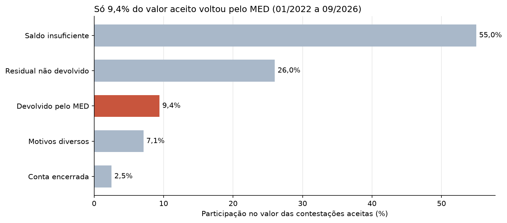
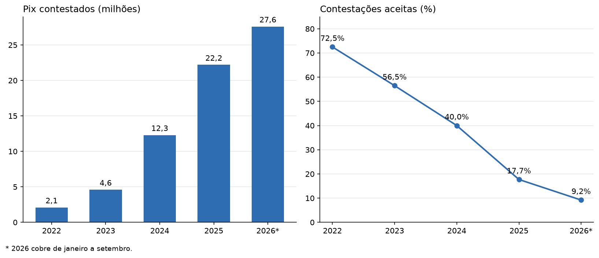

# Fraude no Pix: quanto do dinheiro contestado volta?

Análise em Python e SQL dos dados abertos do Banco Central sobre as contestações de fraude no Pix e o MED (Mecanismo Especial de Devolução).

**Resultado principal:** de R$ 27,57 bilhões em contestações aceitas entre 01/2022 e 09/2026, só R$ 2,59 bilhões (9,4%) voltaram pelo MED. Em 55,0% do valor, não havia saldo suficiente na conta recebedora.



## Principais resultados

| Ano | Pix contestados | Aceitação | Valor aceito | Devolvido pelo MED |
| --- | --- | --- | --- | --- |
| 2022 | 2,1 milhões | 72,5% | R$ 3,02 bi | 6,3% |
| 2023 | 4,6 milhões | 56,5% | R$ 4,35 bi | 9,0% |
| 2024 | 12,3 milhões | 40,0% | R$ 6,69 bi | 8,1% |
| 2025 | 22,2 milhões | 17,7% | R$ 7,77 bi | 9,0% |
| 2026 (jan. a set.) | 27,6 milhões | 9,2% | R$ 5,74 bi | 13,4% |

- A devolução anual subiu de 6,3% para 13,4%, mas ainda deixa a maior parte do valor sem retorno.
- As contestações cresceram muito mais rápido do que as aceitas, e a aceitação caiu de 72,5% para 9,2%.
- O saldo insuficiente é a principal barreira, o que sugere que bloquear o dinheiro cedo pesa mais do que aceitar a contestação depois.



## Como foi feito

1. Coleta na API de dados abertos do Banco Central, com [`coletar.py`](coletar.py).
2. Conferência da base: 57 meses, sem valores ausentes. Os destinos somam exatamente o valor aceito, e o percentual calculado reproduz o publicado.
3. Consultas em SQL com CTEs e funções de janela, em [`sql/consultas.sql`](sql/consultas.sql).
4. Gráficos e conclusões em [`analise.ipynb`](analise.ipynb).

## Como rodar

```bash
pip install -r requirements.txt
python coletar.py
jupyter notebook analise.ipynb
```

O arquivo `dados/fraudes_pix.csv` já vem no repositório, então a coleta é opcional. Rodá-la de novo atualiza os dados, e os números podem mudar.

## Limites

- A base é agregada, então não mostra diferenças por instituição, região ou tipo de golpe.
- A análise não explica a causa da queda na aceitação, que pode refletir regras, canais de contestação ou o perfil dos pedidos.
- Os bloqueios cautelares devolvidos (R$ 3,95 bilhões) não entram no percentual, porque a base não diz se há sobreposição com o MED.
- Os meses mais recentes podem ser revisados pelo Banco Central.

Desenvolvido com apoio do Claude Code.
